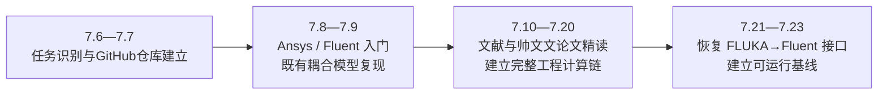
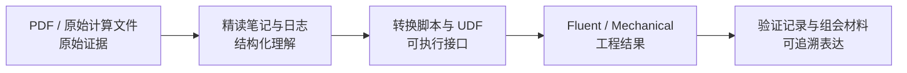
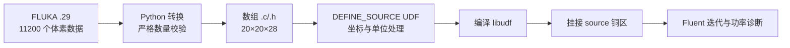
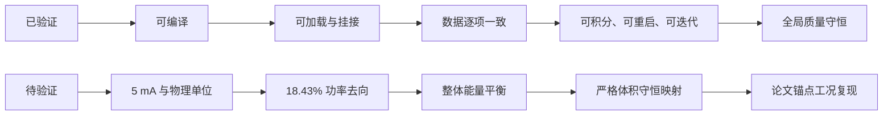
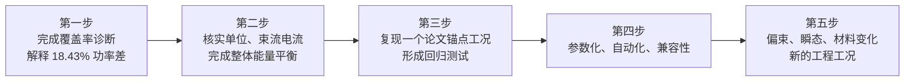

# 2026-07-23 组会汇报 PPT 源稿

> 状态：组会前工作稿  
> 素材范围：2026-07-06 至 2026-07-23 仓库中全部现有实习日志，以及 7 月 23 日数据一致性验证与 UDF 覆盖率诊断提交。  
> 汇报定位：说明本人如何从软件初学者进入已有模型维护者阶段；不把课题组已有成果包装为个人科研成果。

---

## 第 1 页｜从软件学习到 FLUKA–Fluent 耦合链接手

### 标题

**从软件学习到 FLUKA–Fluent 热源耦合链接手**

副标题：2026 年暑期实习阶段进展（7 月 6 日—7 月 23 日）

### 阶段时间线



### 口头说明

这段时间的工作不是直接提出新结构或新物理结论，而是完成已有工作的理解、软件接入和数据接口恢复，为后续独立计算建立基础。

---

## 第 2 页｜工作资产与文件关系

### 代表性目录树

```text
monte-carlo-particle-transport-internship-2026/
├── 01-daily-log/                 # 每日过程、结果和问题边界
├── 04-literature/                # 相关论文及专题综合
├── 05-reference/
│   └── LIT-001/                  # 帅文文论文证据源、页码地图、精读笔记
├── 05-software/ansys/            # Workbench / Fluent 学习和操作记录
├── 06-cases/                     # 算例与模型复现材料
├── fluka_to_c_translation/
│   ├── input/                    # FLUKA .29 原始计分数据
│   ├── output/                   # C 三维数组 .c/.h
│   ├── udf/                      # Fluent UDF 与诊断程序
│   └── verification/             # 数据一致性验证记录
└── 08-presentation/group-meeting/# 组会 PPT 源稿与发言稿
```

### 文件之间的工作关系



### 口头说明

仓库不只是保存代码，而是将原始证据、理解过程、可执行程序、计算结果和汇报材料串联起来。任何结论都应能回溯到原始文件和验证记录。

---

## 第 3 页｜阶段一：Ansys 入门与既有模型复现

### 学习与接手流程


### 已完成内容

- 跑通二维和三维 Fluent 基础案例，完成 VOF 瞬态计算、动画输出和数值稳定性调试；
- 识别既有 Workbench 工程中 Fluent 温度场向 Mechanical 体温度载荷的传递；
- 补齐原环境缺失的 UDF 后完成短迭代复现；
- 使用冷却水质量流量和温升独立估算换热功率，已有工况约为 32.48 kW。

### 能力边界

已具备读取、运行和检查已有模型的基础能力；尚未完成复杂模型的独立重建、完整收敛验证和网格无关性分析。

---

## 第 4 页｜阶段二：建立完整工程计算链


### 形成的关键认识

- 准直器将不可避免的束损集中到可冷却、可屏蔽、可维护的位置；
- 局部功率密度而非单纯总沉积功率决定热点和热应力风险；
- 热工结果首先取决于 FLUKA 输出、单位归一化、坐标映射和热源加载是否正确；
- 论文复现应作为回归测试锚点，工程重点是守恒、真实边界、兼容性和扩展性。

---

## 第 5 页｜阶段三：恢复 FLUKA→Fluent 热源接口

### 数据与程序目录

```text
fluka_to_c_translation/
├── input/
│   └── beam_1mrad_offset_2mm.29
├── fluka_to_c_array_converter.py
├── output/
│   ├── beam_1mrad_offset_2mm_heat_deposition.c
│   └── beam_1mrad_offset_2mm_heat_deposition.h
├── udf/
│   ├── beam_1mrad_offset_2mm_source_udf.c
│   └── beam_1mrad_offset_2mm_coverage_diagnostic.c
└── verification/
    └── beam_1mrad_offset_2mm_verification.md
```

### 恢复链路



### 7 月 23 日新增验证

- `.29` 与 C 数组逐项比较：11200 项全部一致；
- 不一致数量、最大绝对误差、最大相对误差均为 0；
- 数组排列顺序验证通过；
- 主力机参与 Fluent 编译的 `.c/.h` 文件哈希与仓库验证版本一致；
- 已建立串行 Fluent 体素覆盖率诊断程序，用于进一步解释映射功率差异。

---

## 第 6 页｜当前基线结果与可信度边界

### 当前关键数值

| 项目 | 当前结果 | 说明 |
|---|---:|---|
| FLUKA 网格 | 20×20×28 | 11200 个 1 cm³ 体素 |
| 数据转换一致性 | PASS | 11200 项逐项误差为 0 |
| 完整计分盒参考功率 | 46.800 kW | 暂按 5 mA 与当前换算系数 |
| Fluent 四区域映射功率 | 38.175 kW | 当前恢复率约 81.57% |
| 未恢复功率 | 约 8.625 kW | 约 18.43%，原因待诊断 |
| source 区最高温 | 209.99 ℃ | 第 610 步第一版运行基线 |
| 全局质量流量净值 | 约 0 | 入口与出口质量守恒 |

### 已验证 / 待验证



### 口头说明

当前成果的准确定位是“可运行、可检查、可重启的第一版工程基线”，而不是经过完整物理验证的最终工程结果。

---

## 第 7 页｜下一步：从模型维护者走向模型开发者



### 近期优先级

1. 运行串行体素覆盖率诊断，输出分体素覆盖体积和功率差；
2. 交叉核实 FLUKA 单位、每初级粒子归一化和 5 mA 工况；
3. 提取入口/出口焓流和壁面热流，完成整体能量守恒；
4. 选择一个论文正常工况作为回归测试；
5. 再开展网格自动读取、工况切换、区域名称化和版本兼容。

### 结束语

目前已从软件初学者进入已有模型维护者阶段。下一阶段目标不是继续堆迭代次数，而是把数据、物理和工程边界逐项验证清楚，并逐步形成可扩展的耦合工具链。
